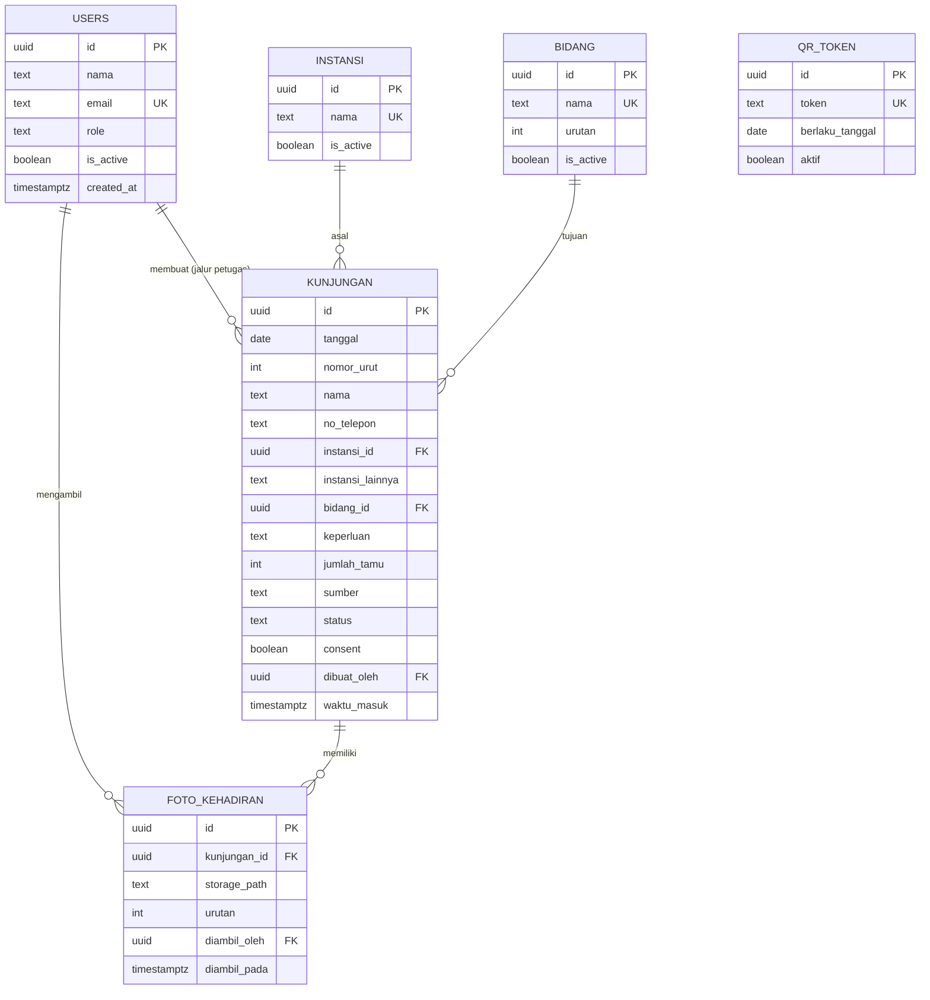

# ERD: SIKUNJUNG Inspektorat Kabupaten Bangli

Versi 1.0 · November 2026 · Database: PostgreSQL (Supabase)

## 1. Gambaran relasi

- Satu **instansi** memiliki banyak **kunjungan**.
- Satu **bidang** dituju oleh banyak **kunjungan**.
- Satu **kunjungan** memiliki 0 sampai 5 **foto_kehadiran**.
- Satu **user** (petugas) mengambil banyak **foto_kehadiran** dan dapat membuat banyak **kunjungan** (jalur petugas).
- **qr_token** berdiri sendiri, dipakai untuk memvalidasi form publik.

## 2. Diagram

## 3. Kamus data

### users

| Kolom | Tipe | Keterangan |
|---|---|---|
| id | uuid, PK | Sama dengan id di Supabase Auth |
| nama | text | Nama petugas atau admin |
| email | text, unik | Untuk login |
| role | text | `admin` atau `petugas` |
| is_active | boolean | Nonaktifkan tanpa menghapus |
| created_at | timestamptz | Otomatis |

### instansi

| Kolom | Tipe | Keterangan |
|---|---|---|
| id | uuid, PK | |
| nama | text, unik | Contoh: Dinas PUPR, BPKAD |
| is_active | boolean | Disembunyikan dari dropdown bila false |

### bidang

| Kolom | Tipe | Keterangan |
|---|---|---|
| id | uuid, PK | |
| nama | text, unik | Sekretariat, Irban I, Irban II, dan seterusnya |
| urutan | int | Urutan di dropdown |
| is_active | boolean | |

### kunjungan

| Kolom | Tipe | Keterangan |
|---|---|---|
| id | uuid, PK | |
| tanggal | date | Tanggal kunjungan, dasar nomor urut |
| nomor_urut | int | Unik bersama tanggal (tanggal, nomor_urut) |
| nama | text, wajib | |
| no_telepon | text, opsional | |
| instansi_id | uuid, FK | Null bila memilih "Lainnya" |
| instansi_lainnya | text | Diisi bila instansi tidak ada di daftar |
| bidang_id | uuid, FK | Bidang yang dituju |
| keperluan | text, opsional | Catatan singkat |
| jumlah_tamu | int | Default 1, untuk rombongan |
| sumber | text | `qr` atau `petugas` |
| status | text | `menunggu_foto`, `tercatat`, `tidak_diverifikasi` |
| consent | boolean | Persetujuan penggunaan data |
| dibuat_oleh | uuid, FK, null | Petugas pembuat, kosong untuk jalur QR |
| waktu_masuk | timestamptz | Diisi server secara otomatis |

### foto_kehadiran

| Kolom | Tipe | Keterangan |
|---|---|---|
| id | uuid, PK | |
| kunjungan_id | uuid, FK | Cascade: foto ikut terhapus bila kunjungan dihapus |
| storage_path | text | Lokasi file di storage privat |
| urutan | int | 1 sampai 5 |
| diambil_oleh | uuid, FK | Petugas yang memotret |
| diambil_pada | timestamptz | Otomatis |

### qr_token (opsional, untuk QR berganti harian)

| Kolom | Tipe | Keterangan |
|---|---|---|
| id | uuid, PK | |
| token | text, unik | Disisipkan di URL QR |
| berlaku_tanggal | date | |
| aktif | boolean | |

## 4. Aturan di database

- Batas unik pada (tanggal, nomor_urut) di tabel kunjungan.
- Batas unik pada (kunjungan_id, urutan) di foto_kehadiran, dengan urutan antara 1 dan 5.
- Pemicu otomatis: saat foto pertama tersimpan, status kunjungan berubah menjadi `tercatat`.
- Tugas terjadwal harian: kunjungan `menunggu_foto` berumur lebih dari 24 jam diubah menjadi `tidak_diverifikasi`.
- Indeks pada kunjungan(tanggal), kunjungan(status), dan kunjungan(instansi_id) untuk filter dan rekap.

## 5. Hak akses (Row Level Security)

| Tabel | Publik (tamu) | Petugas | Admin |
|---|---|---|---|
| kunjungan | Hanya tambah (lewat endpoint terkontrol) | Lihat, tambah, ubah | Semua, termasuk hapus |
| foto_kehadiran | Tidak ada akses | Lihat, tambah, hapus foto milik kunjungan hari berjalan | Semua |
| instansi dan bidang | Hanya baca (untuk dropdown) | Hanya baca | Semua |
| users | Tidak ada akses | Baca profil sendiri | Semua |
| qr_token | Tidak ada akses | Baca | Semua |
